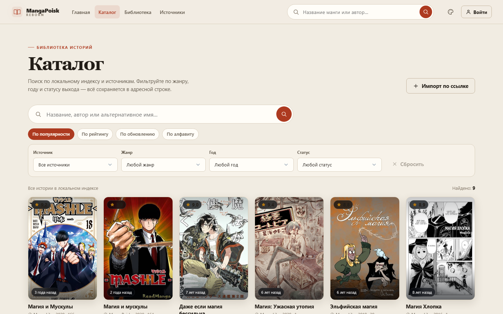
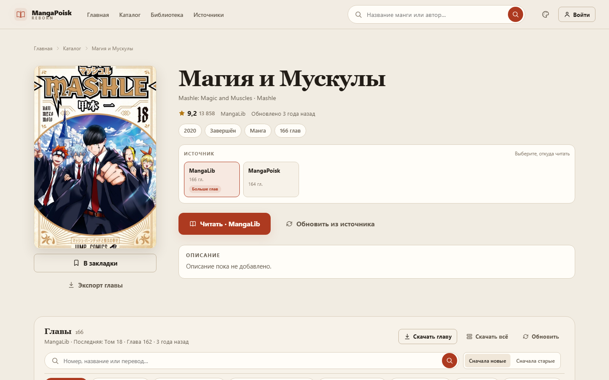
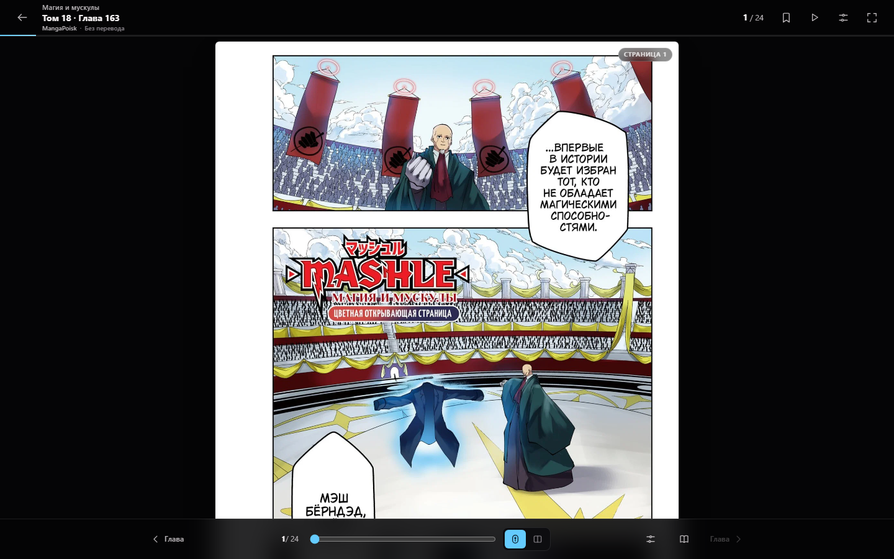
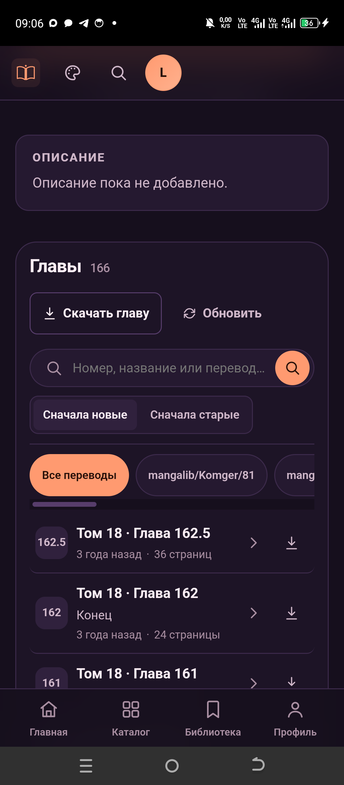
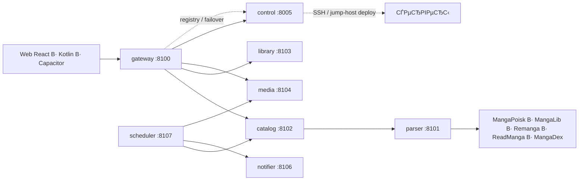
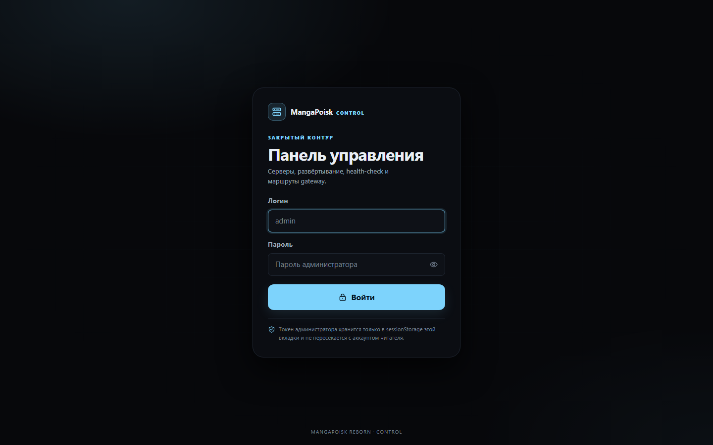

# MangaPoisk Reborn

<p align="center">
  <a href="https://github.com/geekAmis/mangapoiskAPI/actions/workflows/ci.yml"></a>
  <a href="https://github.com/geekAmis/mangapoiskAPI/releases"></a>
  <a href="LICENSE"></a>
  
  
  
  <a href="https://85.192.37.58.nip.io:8443"></a>
</p>

Русскоязычный каталог и читалка манги: FastAPI-микросервисы, React SPA,
нативный Kotlin-клиент, Node.js/Capacitor-сборка, офлайн-библиотека и
админка для управления серверами.

**Демо:** <https://85.192.37.58.nip.io:8443><br>
**Админка:** <https://85.192.37.58.nip.io:8443/admin> (прямая ссылка, в меню её нет)<br>
**API:** <https://85.192.37.58.nip.io:8443/api/v1/health>

> Демо работает по HTTP, без домена и TLS. Для публичного деплоя обязательно
> поставьте HTTPS-прокси. Подробности — в [docs/DEPLOYMENT.md](docs/DEPLOYMENT.md).


## Статус

- `v1.0.0` — опубликованный релиз от 11.11.2026.
- `main` — подготовка `v1.1.0`: офлайн-библиотека, dancing-спиннеры, усиление
  админки и надёжности server manager. Черновик описания релиза:
  [docs/RELEASE_NOTES_v1.1.0.md](docs/RELEASE_NOTES_v1.1.0.md).
- CI: [GitHub Actions](https://github.com/geekAmis/mangapoiskAPI/actions/workflows/ci.yml).
- Разработка идёт по шагам в [issues](https://github.com/geekAmis/mangapoiskAPI/issues);
  эпик — [#3](https://github.com/geekAmis/mangapoiskAPI/issues/3).

## Что умеет

- **Каталог и поиск** по локальному индексу и источникам: жанры, годы,
  статус, сортировки, импорт по ссылке.
- **Карточка тайтла** с вариантами источника и перевода. Кнопка «Читать»
  выбирает источник, где больше глав; фильтр — `source/translator/count`.
- **Читалка**: вертикальная, webtoon и постраничная; авто-скролл, пинч-зум,
  горячие клавиши, сохранение прогресса.
- **Офлайн-библиотека**: скачивание отдельной главы или всего тайтла, очередь
  с докачкой, удаление и чтение без сети. В браузере — IndexedDB, в
  Capacitor — Filesystem/Preferences, в Kotlin-клиенте — Room/WorkManager.
- **Экспорт** главы в CBZ, PDF или HTML-ZIP.
- **Серверный архив**: маленькие страницы — BLOB в SQLite, большие — ZIP;
  читалка сначала берёт архив, потом источник.
- **Шесть тем** (`midnight`, `noir`, `oni`, `crimson`, `sunset`, `paper`) и
  16 dancing-GIF вместо скучных спиннеров.
- **Два Android-клиента**: Kotlin/Jetpack Compose и Node.js/Capacitor.
- **Админка `/admin`**: серверы, SSH-деплой (включая jump-host), health,
  registry, переключение маршрутов, audit log.
- **Источники**: MangaPoisk и MangaLib включены; Remanga, ReadManga и MangaDex
  реализованы, но выключены по умолчанию (robots/сеть). Честный статус —
  РІ [docs/SOURCES.md](docs/SOURCES.md).

## Скриншоты

| Каталог | Карточка тайтла |
|---|---|
|  |  |

| Читалка | Офлайн-библиотека |
|---|---|
|  |  |

| Dancing loader | Boot loader |
|---|---|
|  |  |

| Kotlin / Compose | Node.js / Capacitor |
|---|---|
|  |  |

## Архитектура



| Сервис | Docker Compose (dev) | Production (systemd) | Ответственность |
|---|---:|---:|---|
| `gateway` | 8000 | 8100 | публичный `/api/v1`, rate limit, агрегация |
| `parser` | 8001 | 8101 | адаптеры источников |
| `catalog` | 8002 | 8102 | каталог, поиск, импорт, главы |
| `library` | 8003 | 8103 | аккаунты, закладки, прогресс, настройки |
| `media` | 8004 | 8104 | кэш картинок, экспорт, архив |
| `control` | 8005 | 8005 | серверы, SSH-деплой, health registry |
| `notifier` | 8006 | 8106 | Telegram |
| `scheduler` | — | 8107 (без HTTP) | refresh каталога, очистка |
| `web` | 8080 | 8088 (nginx) | React-СЃР±РѕСЂРєР° Рё `/api` |

В production наружу смотрит только nginx на `8088`; backend-порты слушают
`127.0.0.1`. Docker Compose использует другую нумерацию (8000–8006) — это
нормально для локального запуска. Подробнее:
[docs/ARCHITECTURE.md](docs/ARCHITECTURE.md) Рё
[docs/SERVER_MANAGER.md](docs/SERVER_MANAGER.md).

## Быстрый старт

Нужны Docker Engine/Desktop с Compose v2 и Python 3.12+ (только чтобы
сгенерировать секреты).

```bash
git clone https://github.com/geekAmis/mangapoiskAPI.git
cd mangapoiskAPI
cp .env.example .env

python -c "import secrets; print('JWT_SECRET='+secrets.token_urlsafe(48)); print('INTERNAL_TOKEN='+secrets.token_urlsafe(48)); print('CONTROL_SECRET_KEY='+secrets.token_urlsafe(48))"
```

Вставьте значения в `.env`, задайте свой `ADMIN_PASSWORD` и запустите:

```bash
docker compose up -d --build
```

- сайт — <http://localhost:8080>
- проверка — <http://localhost:8080/api/v1/health>
- Swagger — <http://localhost:8000/docs> после
  `docker compose --profile dev up -d gateway-public`

Первый импорт:

```bash
curl -X POST http://localhost:8080/api/v1/manga/import \
  -H "Content-Type: application/json" \
  -d '{"source":"mangapoisk","url":"https://mangapoisk.me/manga/zombie-slasher"}'
```

## Запуск без Docker

Нужны Python 3.12+, Node.js 20.19+ и несколько терминалов.

```bash
python -m venv .venv
source .venv/bin/activate        # Windows: .venv\Scripts\Activate.ps1
pip install -e packages/manga_common
pip install -r services/parser/requirements.txt
pip install -r services/catalog/requirements.txt
pip install -r services/library/requirements.txt
pip install -r services/media/requirements.txt
pip install -r services/control/requirements.txt
pip install -r services/gateway/requirements.txt
pip install -r services/scheduler/requirements.txt
pip install -r services/notifier/requirements.txt
```

Скопируйте `.env.example` в `.env`, оставьте SQLite-URL и запустите
`scripts/dev.ps1` (parser, catalog, library, media, notifier, gateway) или
поднимайте сервисы вручную. Frontend:

```bash
cd apps/web
npm install
npm run dev
```

Vite проксирует `/api` на `http://localhost:8000`. Полная инструкция:
[docs/DEVELOPMENT.md](docs/DEVELOPMENT.md).

## API

Базовый URL — `/api/v1`. В Docker dev: `http://localhost:8000/api/v1` (через
`gateway-public`) или `http://localhost:8080/api/v1` (через nginx). В
production: `https://85.192.37.58.nip.io:8443/api/v1`.

```http
GET  /api/v1/manga/search?q=магия&live=true
GET  /api/v1/manga/{id}
GET  /api/v1/manga/{id}/variants
GET  /api/v1/chapters/{id}
GET  /api/v1/chapters/{id}/images/1
POST /api/v1/chapters/{id}/exports?format=cbz
POST /api/v1/manga/{id}/warm
```

Полный контракт, коды ошибок и internal-маршруты:
[docs/API.md](docs/API.md).

## Android

- **Kotlin / Jetpack Compose** — `apps/android`, нативное приложение с Room,
  WorkManager и офлайн-загрузками.
- **Node.js / Capacitor** — `apps/mobile`, та же React-сборка в APK; использует
  офлайн-библиотеку web-клиента.

```bash
# Kotlin
cd apps/android && ./gradlew assembleDebug

# Node.js / Capacitor
cd apps/mobile && npm install && npm run sync
npx cap add android   # один раз
npm run apk
```

Debug-сборка Kotlin по умолчанию смотрит на `http://127.0.0.1:8000/api/v1/`
(`adb reverse tcp:8000 tcp:8000`), эмулятор — `http://10.0.2.2:8000/api/v1/`.
Release APK пока не подписан. Инструкции:
[docs/ANDROID.md](docs/ANDROID.md) Рё [apps/mobile/README.md](apps/mobile/README.md).

## Админка и серверы

Панель — `/admin`, логин и пароль из `ADMIN_USERNAME` / `ADMIN_PASSWORD`.
Через неё можно добавить сервер по IP/логину/паролю, выбрать сервисы и порты,
развернуть их по SSH (напрямую или через jump-host), посмотреть лог и health,
синхронизировать registry и переключить трафик на здоровый узел.

Пароли SSH шифруются ключом из `CONTROL_SECRET_KEY` и наружу не отдаются.
Смена `ADMIN_USERNAME`/`ADMIN_PASSWORD` инвалидирует старые админ-сессии
(`401 admin_session_expired`); в production пароль по умолчанию запрещён.
Подробнее: [docs/SERVER_MANAGER.md](docs/SERVER_MANAGER.md).



## Безопасность и право

- Секреты — только в `.env`; `.env`, cookies и `data.txt` не коммитятся.
- В production обязательны свои `JWT_SECRET`, `INTERNAL_TOKEN`,
  `ADMIN_PASSWORD` Рё `CONTROL_SECRET_KEY`.
- Internal-маршруты требуют `X-Internal-Token`; gateway не принимает
  произвольные URL картинок, а media перепроверяет DNS/redirect и блокирует
  private-host, metadata и не-растровые ответы (SSRF).
- Админ-вход ограничен 5 неудачными попытками за 5 минут на IP; токен по
  умолчанию живёт 60 минут (`ADMIN_TOKEN_MINUTES`).
- Проект не хранит мангу у себя: каталог и проксирование изображений с
  источников, без обхода paywall/DRM/anti-bot. Если вы правообладатель —
  откройте issue.
- Для публичного деплоя нужен HTTPS и ограничение `MEDIA_ALLOWED_HOSTS`.

Правила и чек-лист оператора: [docs/LEGAL.md](docs/LEGAL.md) и
[docs/SOURCES.md](docs/SOURCES.md).

## Тесты

```bash
pytest
ruff check .

cd apps/web
npm run typecheck
npm run build
```

Android: `cd apps/android && ./gradlew assembleDebug`. Сетевые тесты парсера
включены только по `RUN_NETWORK_TESTS=1` и не входят в обычный прогон.

## Ограничения

- HTTPS/домен пока не настроены; демо работает по HTTP.
- Production использует SQLite на одном узле. Приоритетный роутинг и failover
  есть; репликация данных в разработке и в production пока не включена.
- Release APK не подписан, iOS-сборки нет.
- Remanga, ReadManga и MangaDex выключены по умолчанию.
- Android-клиент не запускает экспорт CBZ/PDF/HTML и не имеет UI импорта;
  офлайн-каталог целиком не кэшируется.

## Roadmap и участие

Ближайшие планы — [docs/ROADMAP.md](docs/ROADMAP.md). История изменений —
[docs/CHANGELOG.md](docs/CHANGELOG.md). Перед PR прочитайте
[CONTRIBUTING.md](CONTRIBUTING.md); для небольших задач ищите
[good first issue](https://github.com/geekAmis/mangapoiskAPI/labels/good%20first%20issue).

## Лицензия

Код — MIT, см. [LICENSE](LICENSE). Лицензия не даёт прав на стороннюю мангу,
переводы, изображения и торговые марки.
