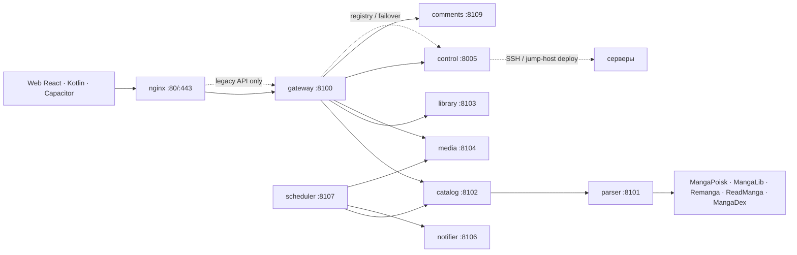

# MangaPoisk Reborn

<p align="center">
  <a href="https://github.com/geekAmis/mangapoiskAPI/actions/workflows/ci.yml"></a>
  <a href="https://github.com/geekAmis/mangapoiskAPI/releases"></a>
  <a href="LICENSE"></a>
  
  
  
  <a href="https://85.192.37.58.nip.io"></a>
</p>

Русскоязычный каталог и читалка манги: FastAPI-микросервисы, React SPA,
нативный Kotlin-клиент, Node.js/Capacitor-сборка, офлайн-библиотека,
комментарии, профили и админка для управления серверами.

**Production (HTTPS):** <https://85.192.37.58.nip.io><br>
**API health:** <https://85.192.37.58.nip.io/api/v1/health><br>
**Админка:** <https://85.192.37.58.nip.io/admin> (прямая ссылка, в меню её нет)<br>
**ads.txt:** <https://85.192.37.58.nip.io/ads.txt> (9 строк, `text/plain`)

> Production работает на стандартных портах **80/443**. Сертификат Let's Encrypt
> покрывает apex и `www`, действует до **2027-02-11**, продление — webroot
> `/var/www/certbot`. `http://` и `www` отвечают 301 на apex HTTPS.
>
> **Legacy:** `:8443` — только API для старого APK 1.3.0; веб-страницы на нём
> отвечают 301 на 443. `:8088` — 301 на 443 для всех путей, кроме прямого
> `/ads.txt`. Не используйте эти порты в новых клиентах и документации.


## Статус

- **Production:** v1.3.2, задеплоен 13.11.2026. Тег `v1.3.2` — `affe7d0`;
  отдельного GitHub release и APK-ассета для него пока нет.
- **Предыдущий релиз:** `v1.3.0` — `71be724`, GitHub release опубликован.
  Тега `v1.3.1` нет: порт-миграция и Android-регрессия вошли в историю
  между `v1.3.0` и `v1.3.2`.
- **Android:** APK **1.3.2 / versionCode 5** установлен на TECNO KL6,
  packaged `www`, origin `https://localhost`, API на 443. QA приостановлен
  владельцем (#84), публикация APK не выполнялась.
- **Монетизация:** Яндекс РСЯ RTB-код, блок `R-A-20411736-1` и `ads.txt`
  развёрнуты. Реальный показ заблокирован на стороне Яндекса:
  `PAGE_DISABLED Page "20411736" is disabled`; модерация РСЯ отклонена из-за
  <100 реальных посетителей в неделю, повторная подача — с 20.11.2026 05:55.
- **Не в production:** HentaiLib (#45), AI-супервизор деплоя (#75), поиск по
  авторам/исправление `чензо мен` (#76), Яндекс Метрика и traffic-панель (#85).
  Это ветки/следующий релиз, а не текущие возможности.
- **Открытые блокеры:** SSH key-only (#78), web/admin hardening (#79),
  owner actions по портам (#82) и RTB (#83), Android QA (#84), трафик (#85).
- CI: [GitHub Actions](https://github.com/geekAmis/mangapoiskAPI/actions/workflows/ci.yml).
  Текущий GO/NO-GO — [docs/LAUNCH.md](docs/LAUNCH.md).

## Что умеет

- **Каталог и поиск** по локальному индексу и источникам: жанры, годы,
  статус, сортировки, импорт по ссылке. В production видно около **25 тыс.**
  тайтлов при **78 тыс.+** строк каталога; sitemap содержит ~25 189 URL.
  Поиск по автору и проблемные опечатки вроде `чензо мен` — известный gap
  #76, в v1.3.2 не исправлен.
- **Карточка тайтла** с вариантами источника и перевода, блоком «Похожее» и
  публичными подборками. Кнопка «Читать» выбирает источник, где больше глав;
  фильтр — `source/translator/count`.
- **Читалка**: вертикальная, webtoon и постраничная; авто-скролл до 600 px/s,
  пинч-зум, горячие клавиши, сохранение прогресса и повторные попытки загрузки.
  Подсказка «Продолжить со страницы N?» не появляется поверх уже начатой главы
  (#81).
- **Офлайн-библиотека**: скачивание отдельной главы или всего тайтла, очередь
  с докачкой, удаление и чтение без сети. В браузере — IndexedDB, в
  Capacitor — Filesystem/Preferences, в Kotlin-клиенте — Room/WorkManager.
- **Профили и геймификация**: `/u/{username}`, XP, уровни, звания,
  достижения, события, приватность и модерация (#47).
- **Комментарии к тайтлам**: ответы, лайки, спойлеры, редактирование, жалобы,
  модерация в админке и уведомления о reply/like.
- **Серверный архив**: маленькие страницы — BLOB в SQLite, большие — ZIP;
  читалка сначала берёт архив, потом источник. Archive LRU ограничивает диск
  (около 25 GiB), метаданные и обложки не вытесняются.
- **SEO**: стабильные slug-URL `/manga/{id}-{slug}`, 301 со старых и stale
  slug, серверный prerender для ботов, noindex для приватных разделов,
  sitemap без 18+ и без порта в canonical/OG.
- **Юридические страницы**: `/terms`, `/privacy`, `/dmca`, `/contacts`, `/age`
  с реальными контактами, cookie-баннером и age-gate.
- **Яндекс ID**: OAuth 2.0, DB-only зашифрованные ключи, вход подтверждён на
  production; управление — `Админка → Интеграции → Яндекс ID`.
- **Админка `/admin`**: вкладки, deep links, серверы, SSH-деплой (включая
  jump-host), health, registry, deploy jobs, catalog/media/ads/comments,
  реальная интеграция Яндекс ID, audit log и ограниченная серверная консоль.
- **Наблюдаемость**: health, p95/5xx/SQLite lock метрики, backup age,
  watchdog и панель в админке.
- **Источники**: MangaPoisk, MangaLib и Remanga; ReadManga и MangaDex
  реализованы, но выключены по умолчанию (robots/сеть). Честный статус,
  ограничения и cookie — в [docs/SOURCES.md](docs/SOURCES.md).
- **Шесть тем** (`midnight`, `noir`, `oni`, `crimson`, `sunset`, `paper`) и
  16 dancing-GIF вместо скучных спиннеров.
- **Два Android-клиента**: Kotlin/Jetpack Compose и Node.js/Capacitor.
  Production-APK 1.3.2 — Capacitor-сборка.
- **Серверный экспорт** глав в CBZ, PDF или HTML-ZIP через API; пользовательский
  UI экспорта убран в рамках cleanup
  [#36](https://github.com/geekAmis/mangapoiskAPI/issues/36).

## Скриншоты

| Каталог | Карточка тайтла |
|---|---|
|  |  |

| Читалка | Офлайн-библиотека |
|---|---|
|  |  |

| Dancing loader | Boot loader |
|---|---|
|  |  |

| Kotlin / Compose | Node.js / Capacitor |
|---|---|
|  |  |

## Архитектура



| Сервис | Docker Compose (dev) | Production (systemd) | Ответственность |
|---|---:|---:|---|
| `nginx` / `web` | 8080 | **80/443** | сайт, `/api`, статика; `:8443` legacy API, `:8088` redirect |
| `web-internal` | — | 8089 (loopback) | `index.html` для gateway prerender (`WEB_INTERNAL_URL`) |
| `gateway` | 8000 | 8100 | публичный `/api/v1`, rate limit, агрегация |
| `parser` | 8001 | 8101 | адаптеры источников |
| `catalog` | 8002 | 8102 | каталог, поиск, импорт, главы |
| `library` | 8003 | 8103 | аккаунты, профили, закладки, прогресс, настройки |
| `media` | 8004 | 8104 | кэш картинок, экспорт, архив |
| `control` | 8005 | 8005 | серверы, SSH-деплой, health registry, интеграции |
| `notifier` | 8006 | 8106 | Telegram |
| `scheduler` | — | 8107 (без HTTP) | refresh каталога, очистка |
| `comments` | — | 8109 | комментарии, жалобы, модерация |
| `replica` | — | 8108 | репликация SQLite/архива (в разработке) |

В production наружу смотрят только nginx на **80/443** и legacy-порты
**8443** (API для APK 1.3.0) и **8088** (redirect, кроме `/ads.txt`).
Backend-порты слушают `127.0.0.1`. Docker Compose использует другую нумерацию
(8000–8006) — это нормально для локального запуска. `comments` и `replica`
разворачиваются через server manager/systemd; в Docker Compose они пока не
описаны. Подробнее: [docs/ARCHITECTURE.md](docs/ARCHITECTURE.md),
[docs/DEPLOYMENT.md](docs/DEPLOYMENT.md) и
[docs/SERVER_MANAGER.md](docs/SERVER_MANAGER.md).

## Быстрый старт

Нужны Docker Engine/Desktop с Compose v2 и Python 3.12+ (только чтобы
сгенерировать секреты).

```bash
git clone https://github.com/geekAmis/mangapoiskAPI.git
cd mangapoiskAPI
cp .env.example .env

python -c "import secrets; print('JWT_SECRET='+secrets.token_urlsafe(48)); print('INTERNAL_TOKEN='+secrets.token_urlsafe(48)); print('CONTROL_SECRET_KEY='+secrets.token_urlsafe(48))"
```

Вставьте значения в `.env`, задайте свой `ADMIN_PASSWORD` и запустите:

```bash
docker compose up -d --build
```

- сайт — <http://localhost:8080>
- проверка — <http://localhost:8080/api/v1/health>
- Swagger — <http://localhost:8000/docs> после
  `docker compose --profile dev up -d gateway-public`

Первый импорт:

```bash
curl -X POST http://localhost:8080/api/v1/manga/import \
  -H "Content-Type: application/json" \
  -d '{"source":"mangapoisk","url":"https://mangapoisk.me/manga/zombie-slasher"}'
```

## Запуск без Docker

Нужны Python 3.12+, Node.js 20.19+ и несколько терминалов.

```bash
python -m venv .venv
source .venv/bin/activate        # Windows: .venv\Scripts\Activate.ps1
pip install -e packages/manga_common
pip install -r services/parser/requirements.txt
pip install -r services/catalog/requirements.txt
pip install -r services/library/requirements.txt
pip install -r services/media/requirements.txt
pip install -r services/control/requirements.txt
pip install -r services/gateway/requirements.txt
pip install -r services/scheduler/requirements.txt
pip install -r services/notifier/requirements.txt
```

Скопируйте `.env.example` в `.env`, оставьте SQLite-URL и запустите
`scripts/dev.ps1` (parser, catalog, library, media, notifier, gateway) или
поднимайте сервисы вручную. Frontend:

```bash
cd apps/web
npm install
npm run dev
```

Vite проксирует `/api` на `http://localhost:8000`. Полная инструкция:
[docs/DEVELOPMENT.md](docs/DEVELOPMENT.md).

## API

Базовый URL — `/api/v1`. В Docker dev: `http://localhost:8000/api/v1` (через
`gateway-public`) или `http://localhost:8080/api/v1` (через nginx). В
production: `https://85.192.37.58.nip.io/api/v1` (443, без порта в URL).

```http
GET  /api/v1/manga/search?q=магия&live=true
GET  /api/v1/manga/{id}
GET  /api/v1/manga/{id}/variants
GET  /api/v1/manga/{id}/related
GET  /api/v1/collections
GET  /api/v1/chapters/{id}
GET  /api/v1/chapters/{id}/images/1
POST /api/v1/manga/{id}/prepare
GET  /api/v1/manga/{id}/prepare
GET  /api/v1/manga/{id}/comments
POST /api/v1/manga/{id}/comments
GET  /api/v1/users/{handle}
GET  /api/v1/ads/config
POST /api/v1/chapters/{id}/exports?format=cbz
POST /api/v1/manga/{id}/warm
```

Полный контракт, коды ошибок, профили, подборки, Яндекс ID, реклама и
internal-маршруты: [docs/API.md](docs/API.md).

## Android

- **Capacitor APK 1.3.2** — production-сборка `ru.mangapoisk.reborn`,
  versionCode 5. Собрана из `release/android-1.3.2`, packaged `www`, origin
  `https://localhost`, API `https://85.192.37.58.nip.io/api/v1`. Установлена
  поверх 1.3.1 без потери данных; QA приостановлен (#84).
- **Kotlin / Jetpack Compose** — `apps/android`, нативное приложение с Room,
  WorkManager и офлайн-загрузками; не является текущим production-APK.
- **Node.js / Capacitor** — `apps/mobile`, та же React-сборка в APK; использует
  офлайн-библиотеку web-клиента.

```bash
# Kotlin
cd apps/android && ./gradlew assembleDebug

# Node.js / Capacitor (release 1.3.2)
cd apps/mobile && npm install && npm run sync
npx cap add android   # один раз
npm run apk
```

Debug-сборка Kotlin по умолчанию смотрит на `http://127.0.0.1:8000/api/v1/`
(`adb reverse tcp:8000 tcp:8000`), эмулятор — `http://10.0.2.2:8000/api/v1/`.
Публичный API — `https://85.192.37.58.nip.io/api/v1/`. Release APK подписан
production-ключом; GitHub-ассет для 1.3.2 пока не опубликован. Инструкции:
[docs/ANDROID.md](docs/ANDROID.md) и
[apps/mobile/README.md](apps/mobile/README.md).

## Админка и серверы

Панель — `/admin` (прямая ссылка, в меню её нет), логин и пароль из
`ADMIN_USERNAME` / `ADMIN_PASSWORD`. Вкладки: обзор, серверы, деплой,
краулер/каталог, медиа, реклама, комментарии/профили, интеграции, аудит,
терминал. Активная вкладка хранится в URL (`?tab=...`), неизвестная
открывает обзор.

Через админку можно добавить сервер по IP/логину/паролю, выбрать сервисы и
порты, развернуть их по SSH (напрямую или через jump-host), посмотреть лог и
health, синхронизировать registry и переключить трафик на здоровый узел.
`Интеграции → Яндекс ID` хранит реальные ключи OAuth в БД control в
зашифрованном виде; `Интеграции` также управляет cookie источников и импортом
`.har`.

Пароли SSH шифруются ключом из `CONTROL_SECRET_KEY` и наружу не отдаются.
Смена `ADMIN_USERNAME`/`ADMIN_PASSWORD` инвалидирует старые админ-сессии
(`401 admin_session_expired`); в production пароль по умолчанию запрещён.
Cookie источников (например, Remanga) можно задать вручную или импортировать
из `.har`; значение cookie не возвращается в API и не пишется в логи.
Серверная консоль — allowlist read-only команд и структурированных действий,
а не произвольный shell. Подробнее: [docs/SERVER_MANAGER.md](docs/SERVER_MANAGER.md),
[docs/ADMIN.md](docs/ADMIN.md) и [docs/SERVER_CONSOLE.md](docs/SERVER_CONSOLE.md).


## Безопасность и право

- Секреты — только в `.env` или зашифрованной БД control; `.env`, cookies и
  `data.txt` не коммитятся.
- В production обязательны свои `JWT_SECRET`, `INTERNAL_TOKEN`,
  `ADMIN_PASSWORD` и `CONTROL_SECRET_KEY`.
- Internal-маршруты требуют `X-Internal-Token`; gateway не принимает
  произвольные URL картинок, а media перепроверяет DNS/redirect и блокирует
  private-host, metadata и не-растровые ответы (SSRF).
- Админ-вход ограничен 5 неудачными попытками за 5 минут на IP; токен по
  умолчанию живёт 60 минут (`ADMIN_TOKEN_MINUTES`).
- Публичный деплой работает по HTTPS на 80/443 (Let's Encrypt, HSTS, CSP).
  HTTP и `www` отвечают 301; `:8443` — legacy API для APK 1.3.0, `:8088` —
  redirect, кроме `/ads.txt`.
- Юридические страницы опубликованы с реальными контактами:
  `xgemxsite@gmail.com`, владелец `Roman`, юрисдикция `Russia`.
- Проект не хранит мангу у себя: каталог и проксирование изображений с
  источников, без обхода paywall/DRM/anti-bot. Если вы правообладатель —
  откройте issue.
- Для публичного деплоя ограничьте `MEDIA_ALLOWED_HOSTS` и соблюдайте robots
  источников.

Правила и чек-лист оператора: [docs/LEGAL.md](docs/LEGAL.md) и
[docs/SOURCES.md](docs/SOURCES.md). Политика безопасности:
[docs/SECURITY.md](docs/SECURITY.md).

## Тесты

```bash
pytest
ruff check .

cd apps/web
npm run typecheck
npm run build
npm test
```

Android: `cd apps/android && ./gradlew assembleDebug`. Сетевые тесты парсера
включены только по `RUN_NETWORK_TESTS=1` и не входят в обычный прогон.
Документация проверяется `python scripts/check_docs_encoding.py`.

## Ограничения

- Production использует SQLite на одном узле. Приоритетный роутинг и failover
  есть; репликация данных в разработке и в production пока не включена.
- Legacy-порты `:8443` (API только для APK 1.3.0) и `:8088` (redirect)
  остаются до вывода старых клиентов; новые интеграции должны использовать
  443.
- Android QA 1.3.2 приостановлен владельцем; полный smoke (reader, downloads,
  notifications, `/privacy` overflow, Yandex ID) не завершён. GitHub release
  и APK-ассет для 1.3.2 не публиковались.
- Яндекс РСЯ: код и `ads.txt` готовы, но реальный блок заблокирован на
  стороне Яндекса (`PAGE_DISABLED`); модерация площадки ждёт ≥100 реальных
  посетителей/неделю.
- Поиск по автору и проблемные опечатки (`чензо мен`) — открытый #76, в
  production v1.3.2 не исправлены.
- HentaiLib (#45), AI-супервизор (#75) и Яндекс Метрика/traffic-панель (#85)
  не входят в production v1.3.2.
- ReadManga и MangaDex выключены по умолчанию. Remanga доступен, но требует
  соблюдения robots/прав источника; для части глав нужен cookie.
- Android-клиент не запускает экспорт CBZ/PDF/HTML и не имеет UI импорта;
  офлайн-каталог целиком не кэшируется.
- Пользовательский UI экспорта убран; публичные export-маршруты будут
  удалены/скрыты в рамках [#36](https://github.com/geekAmis/mangapoiskAPI/issues/36).

## Roadmap и участие

Текущий GO/NO-GO и блокеры — [docs/LAUNCH.md](docs/LAUNCH.md). История
изменений — [docs/CHANGELOG.md](docs/CHANGELOG.md), интеграционная запись
v1.3.x — [docs/INTEGRATION_v1.3.md](docs/INTEGRATION_v1.3.md). Ближайшие
задачи: #84 (Android QA), #85 (трафик/Метрика), #78 (SSH key-only), #79
(web/admin hardening). Перед PR прочитайте
[CONTRIBUTING.md](CONTRIBUTING.md); для небольших задач ищите
[good first issue](https://github.com/geekAmis/mangapoiskAPI/labels/good%20first%20issue).

## Лицензия

Код — MIT, см. [LICENSE](LICENSE). Лицензия не даёт прав на стороннюю мангу,
переводы, изображения и торговые марки.
